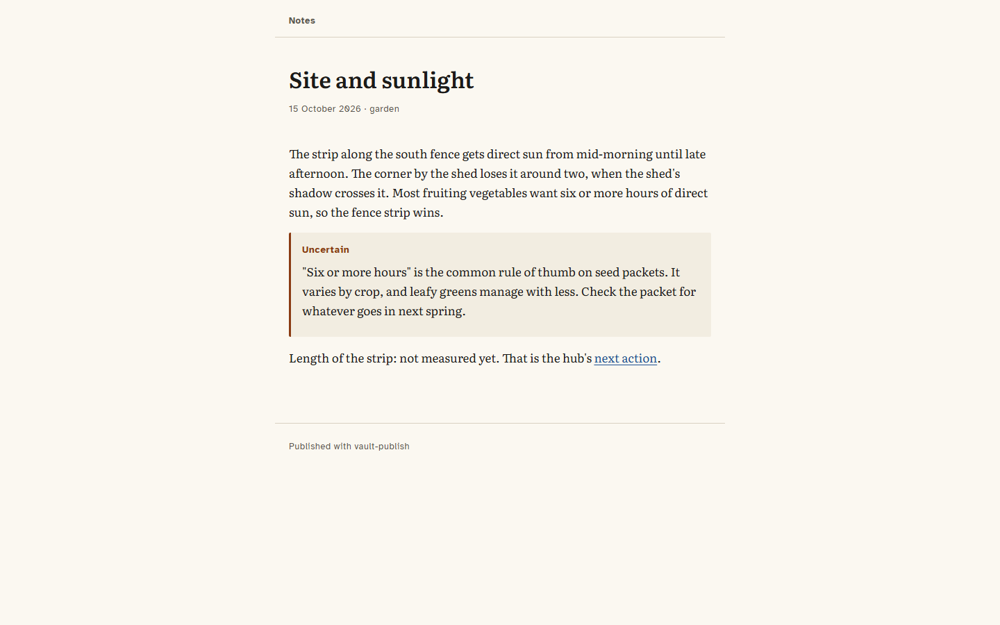

# Second Brain OS

A starter Obsidian vault where AI agents do the filing, and `vault-publish`, a command-line tool that shares chosen notes without exposing the rest.



The vault runs on three habits: capture without deciding, sort once a week, keep one small next step per project. Agents (Claude Code, or any assistant that reads `AGENTS.md`) take the busywork: they capture, propose where things go, run the weekly review, and keep each project's next action current. They propose before they move anything and delete nothing without a yes.

## Two-minute setup

You need [Obsidian](https://obsidian.md) and, for the agents, [Claude Code](https://claude.com/claude-code) or another agent that reads `AGENTS.md`.

1. Copy the `vault` folder to wherever you keep notes, and rename it.
2. In Obsidian, choose **Open folder as vault** and pick it. Open `Home`.
3. Install two community plugins: **Templater** (set its template folder to `99 System/Templates`, and folder templates `00 Inbox` → Capture, `30 Research` → Research, `40 Mind` → Daydream) and **Periodic Notes** (daily notes in `10 Journal/Daily` from `Daily`, weekly in `10 Journal/Weekly` from `Weekly Review`). The core **Bases** plugin draws Home's views.
4. Open a terminal in the vault and start Claude Code. Type `/today`.

The sample notes (a raised-bed project, a note on the bean-field in _Walden_, a daydream) show each folder in use. Delete them when you're ready.

## What is in it

- **`vault/`**: the folder map (`00 Inbox`, `10 Journal`, `20 Projects`, `30 Research`, `40 Mind`, `50 Life`, `90 Archive`, `99 System`), 6 templates, a Home dashboard (`Home.md` plus `99 System/Home.base`), the human manual (`99 System/Vault Guide.md`) and the agent guide (`AGENTS.md`, imported by `CLAUDE.md`).
- **`vault/.claude/skills/`**: 11 skills, each also a slash command in Claude Code: `/capture`, `/inbox`, `/today`, `/win`, `/next`, `/weekly`, `/research`, `/project`, `/ask`, `/cleanup`, `/vault-check`. How they fit together: [docs/agents.md](docs/agents.md).
- **`vault-publish`** (`src/`): select notes by rule, convert Obsidian Markdown, block the export if anything looks private. The model behind it: [docs/privacy-model.md](docs/privacy-model.md).

## vault-publish

```sh
npm ci && npm run build
node dist/cli.js <vault> --publish-flag --dry-run              # what would go out
node dist/cli.js <vault> --publish-flag --out shared           # Markdown folder
node dist/cli.js <vault> --folder "20 Projects/Raised Bed" --publish-flag --format html --out shared
node dist/cli.js <vault> --tag share --deny deny.txt --allow allow.txt --out shared
node dist/cli.js check-links <vault>                           # every link resolves?
```

Nothing is published by default. `--publish-flag`, `--folder` and `--tag` are rules, and a note must pass every rule you give; `publish: false` in a note always wins. Only `publish: true` (or the string `"true"`) counts as consent; `yes` does not.

What it does to each chosen note:

- **Links.** `[[Note]]`, `[[Note|alias]]`, `[[Note#Heading]]`, `[[#Heading]]`, embeds, Markdown links and images, reference definitions and raw HTML `href` and `src` all go through one resolver and become links between the published pages. A link to a note that is not being published becomes plain text: its alias if it has one, otherwise "a private note", so the other note's title never appears. Embeds of private notes are removed. Names resolve the way Obsidian does: an exact path first, then the shortest path among notes with that name. As a last check, any relative link left in the output that is not a published page, a copied attachment or an anchor blocks the export.
- **Obsidian syntax.** `%% comments %%` are removed (an unclosed one hides the rest of the note, as in Obsidian), callouts become titled blockquotes (or styled asides in HTML), `==highlights==` become `<mark>`, block ids are dropped. Code is never touched.
- **Properties.** Only title, date, tags and description leave the vault. `status`, `next`, `project`, `energy` and anything else stay behind.
- **Privacy check.** The converted text, code blocks included, is scanned for email addresses, phone numbers, street addresses, card numbers (Luhn-checked), ID-number patterns, private keys, API keys, tokens and `password = ...` style assignments, plus every word on your `--deny` list. Any finding blocks the export, nothing is written, and the report gives `file:line:column` in the source note, the kind, and the match with its middle hidden. Exact strings on an `--allow` list (your public email, say) pass.
- **Output.** `markdown` writes one `.md` per note plus `index.md`. `html` writes static pages in the [Reading Copy](DESIGN.md) theme with self-hosted fonts. `site` writes `articles.json` in the article shape of [speyyman.github.io](https://speyyman.github.io) (sections of plain paragraphs, a quote, link buttons), and warns about anything that shape can't hold, such as tables.

It refuses to write inside the vault, and refuses to empty a folder it did not write itself.

## Tests

`npm test` runs 102 tests: properties edge cases (BOM, CRLF, empty, broken YAML, `publish: yes`), selection rules, link resolution, every conversion rule against a fixture vault with aliased links, embeds of private notes, nested folders, same-named notes, tables, comments and code; each privacy detector with positive and negative cases; a golden Markdown export of the sample project; HTML and site output; output-folder safety; a planted-secrets vault that must be blocked; the link and attachment cases an independent review found leaking, kept as regression tests; and WCAG contrast for the theme's tokens. `npm run e2e` runs the built binary the way a user would. Fake secrets in the tests are assembled at run time, so the repository never holds a key-shaped string.

## Limitations

- The privacy check is pattern-based. It catches the common shapes of secrets and contact details, not a name or a story; that is what the deny list is for, and it is no substitute for reading what you publish.
- Attachments (images, PDFs) are copied, not scanned. They are copied under their own file name only, never their folder path, and the names are checked against the detectors and your deny list; the report lists every attachment by vault path so you can look. An attachment you embed in a shared note is shared, wherever it lives in the vault.
- Street-address and phone detection are tuned for US and UK formats and will miss others.
- Embedding a published note produces a link to it, not the embedded text.
- The vault's agent workflows depend on Obsidian for moves and renames (so links update); without the Obsidian CLI, agents hand you a list of moves instead.

## Licence

Code: MIT ([LICENSE](LICENSE)). Vault templates, skills and docs: MIT as well, so you can adapt them freely. Fonts and sample sources: [CREDITS.md](CREDITS.md).

Development was assisted by Claude (Anthropic).
